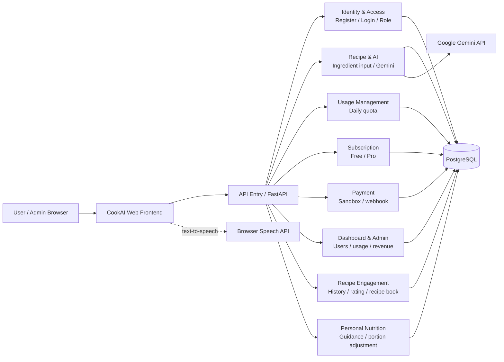
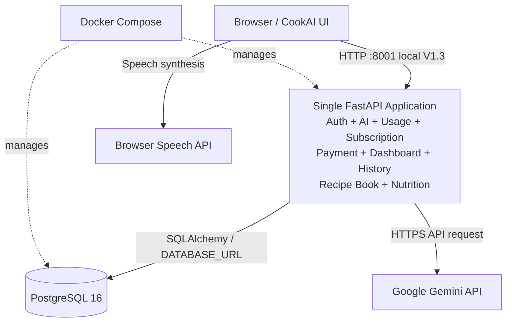

# CookAI — Microservices Architecture

> **Architecture accuracy note:** CookAI V1.3 is currently a **modular monolith**: one FastAPI application contains multiple functional modules and is deployed with PostgreSQL using Docker Compose. The first diagram below is a **proposed logical service decomposition**, not a claim that each box is already an independently deployed microservice. The second diagram shows the current implementation more accurately.

## Proposed logical service architecture

## Current deployment architecture

## Notes
- V1.3 local setup: API host port `8001` → container port `8000`; PostgreSQL host port `5433` → container port `5432`.
- V1.2 previously used host ports `8000` and `5432`.
- Current modules are logical responsibilities inside one FastAPI application, not independent deployed microservices.
- PostgreSQL is the current relational database; Gemini is an external AI service.
- Payment is sandbox-only.
- If an assignment requires a “Microservices Architecture” diagram, label the first diagram as a **proposed logical architecture** and use the current deployment diagram to describe what is actually implemented.
