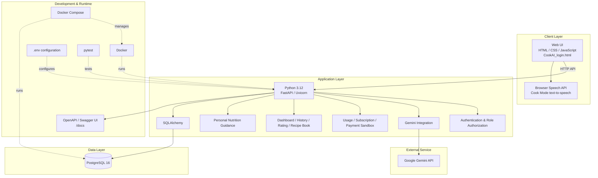

# CookAI — Technology Stack Diagram

## Technology stack summary

| Layer | Technology | Purpose |
|---|---|---|
| Frontend | HTML, CSS, JavaScript | Web interface |
| Backend | Python 3.12, FastAPI, Uvicorn | REST API and application logic |
| Database | PostgreSQL 16 | Persistent application data |
| ORM | SQLAlchemy | Database models and queries |
| AI | Google Gemini API | Recipe recommendation |
| Authentication | Token-based authentication + backend role checks | Login and access control |
| Voice | Browser Speech API | Read cooking steps on supported browsers/devices |
| Containers | Docker, Docker Compose | Local runtime for API and database |
| API documentation | OpenAPI / Swagger UI (`/docs`) | Inspect and test API |
| Testing | pytest | Automated tests |
| Configuration | `.env` / `.env.example` | Secrets and configurable limits |

## Local ports
- V1.3 API: `http://localhost:8001`
- Health: `http://localhost:8001/health`
- Swagger: `http://localhost:8001/docs`
- V1.3 PostgreSQL host port: `5433` (container port `5432`)
- The frontend is not assumed to be a separate Docker container unless the current Compose file explicitly adds one.

## Security reminders
- Never commit `.env`, `GEMINI_API_KEY`, or `SECRET_KEY`.
- `.env.example` should contain placeholders only.
- Payment is sandbox-only.
- AI cost and nutrition values are estimates, not financial accounting or medical advice.
